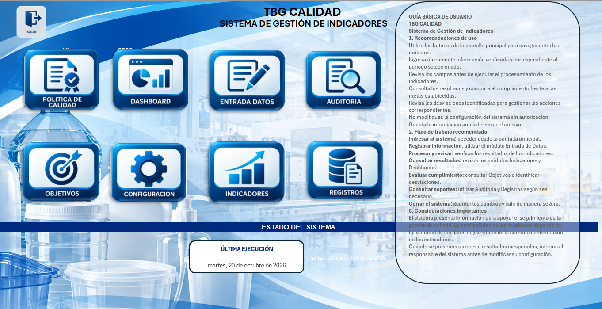

# TBG Calidad v2
### Sistema de Gestión de Indicadores de Calidad

Motor desarrollado en Python para validar, calcular y registrar indicadores de un Sistema de Gestión de Calidad mediante el libro de Excel `TBG_Calidad.xlsm`.

La solución integra Excel y Python para facilitar la administración de objetivos, el seguimiento de indicadores, la validación de datos y el registro histórico de resultados en una empresa manufacturera.

---

## Vista principal del sistema



*Interfaz principal de TBG Calidad: acceso a los módulos de gestión, consulta y seguimiento de indicadores.*

## Características principales

- **Validación de datos:** verifica la consistencia de la información registrada y su correspondencia con el maestro de indicadores.
- **Cálculo de cumplimiento:** procesa los resultados y las ponderaciones de los indicadores.
- **Gestión del histórico:** registra los resultados por período.
- **Control transaccional:** coordina las actualizaciones del histórico y los resultados durante el guardado.
- **Modos de operación:** permite procesar períodos nuevos o corregir períodos registrados.
- **Pruebas automatizadas:** incluye pruebas unitarias para validar componentes críticos del motor.

## Tecnologías y requisitos

### Tecnologías

- Python.
- Microsoft Excel de escritorio.
- Excel con macros (`.xlsm`).
- PyInstaller para la construcción del ejecutable.
- Power Query y Power Pivot, como herramientas de trabajo del libro de Excel.

### Requisitos

- Sistema operativo Windows.
- Microsoft Excel de escritorio.
- Una versión de Python compatible con las dependencias del proyecto.
- Dependencias instaladas desde `requirements.txt`.

## Estructura del proyecto

```text
TGB_Calidad_v2/
├── assets/
│   └── captura-principal.png
├── engine/
│   ├── build_excel_interface.py
│   ├── calculator.py
│   ├── config.py
│   ├── entrada.py
│   ├── excel_transaction.py
│   ├── excel_writer.py
│   ├── historico.py
│   ├── main.py
│   ├── progress_ui.py
│   └── validator.py
├── tests/
│   ├── unit/
│   │   ├── test_calculator.py
│   │   ├── test_excel_transaction.py
│   │   ├── test_historico.py
│   │   └── test_validator.py
│   ├── README.md
│   └── run_tests.py
├── TBG_Calidad.xlsm
├── TBG_Calidad.spec
├── requirements.txt
└── README.md
```

### Componentes

| Componente | Descripción |
|---|---|
| `TBG_Calidad.xlsm` | Libro de Excel e interfaz de trabajo del sistema. |
| `engine/` | Motor Python: validación, cálculos, transacciones, escritura e histórico. |
| `tests/` | Pruebas unitarias automatizadas. |
| `assets/` | Recursos gráficos para la documentación. |
| `requirements.txt` | Dependencias de Python. |
| `TBG_Calidad.spec` | Configuración de PyInstaller para construir el ejecutable. |

## Flujo de procesamiento del motor

1. Lee el período y el modo de operación desde `01_INICIO`.
2. Lee los indicadores registrados en `02_ENTRADA` y su configuración.
3. Valida los datos y su coherencia con el maestro.
4. Calcula el cumplimiento y las ponderaciones.
5. Actualiza `HISTORICO` y `03_RESULTADOS` dentro de una operación de guardado.

### Modos de operación

- **`NORMAL`:** procesa un período nuevo.
- **`CORRECCIÓN`:** permite reemplazar un período previamente registrado.

## Instalación

Clona o descarga el repositorio y abre PowerShell en la carpeta raíz del proyecto.

Instala las dependencias:

```powershell
.\.venv\Scripts\python.exe -m pip install -r requirements.txt
```

El comando supone que el entorno virtual `.venv` ya existe. Si aún no está creado, configura primero un entorno virtual con una versión compatible de Python.

## Ejecución del motor

Desde la raíz del proyecto:

```powershell
Set-Location .\engine
..\.venv\Scripts\python.exe .\main.py
```

### Ejecución segura con una copia de prueba

Para realizar pruebas funcionales, utiliza una copia del libro y evita modificar el archivo operativo.

Desde la raíz del proyecto:

```powershell
Copy-Item .\TBG_Calidad.xlsm .\TBG_Calidad_prueba_local.xlsm

$env:TBG_RUTA_EXCEL = (
    Resolve-Path .\TBG_Calidad_prueba_local.xlsm
).Path

Set-Location .\engine
..\.venv\Scripts\python.exe .\main.py
```

La variable de entorno `TBG_RUTA_EXCEL` permite indicar la ruta del libro que utilizará el motor durante la sesión actual de PowerShell.

## Pruebas unitarias

Desde la raíz del proyecto, ejecuta:

```powershell
.\.venv\Scripts\python.exe .\tests\run_tests.py
```

Las pruebas cubren:

- Cálculos de indicadores y acumulados.
- Validación de datos y consistencia de la configuración.
- Consulta y ordenamiento de registros históricos.
- Comportamiento transaccional ante errores durante el guardado.

**Estado de las pruebas:** en la ejecución registrada durante la preparación del repositorio, las 39 pruebas finalizaron correctamente.

## Construcción del ejecutable

El archivo `TBG_Calidad.spec` contiene la configuración de PyInstaller para construir la aplicación.

La construcción debe realizarse en un entorno que tenga instaladas las dependencias necesarias y la configuración requerida por el proyecto.

## Alcance y consideraciones

Este repositorio contiene el código fuente y los archivos necesarios para el proyecto TBG Calidad v2.

Antes de distribuirlo o utilizarlo en producción:

- Verifica que el libro de Excel, sus macros y sus metadatos no contengan información confidencial.
- Realiza pruebas funcionales con una copia del libro.
- Confirma que las dependencias y la versión de Python sean compatibles con el entorno de ejecución.
- Conserva respaldos de los libros operativos antes de ejecutar correcciones de períodos registrados.

---

**TBG Calidad v2**
*Automatización, validación y seguimiento de indicadores para la gestión de calidad.*
